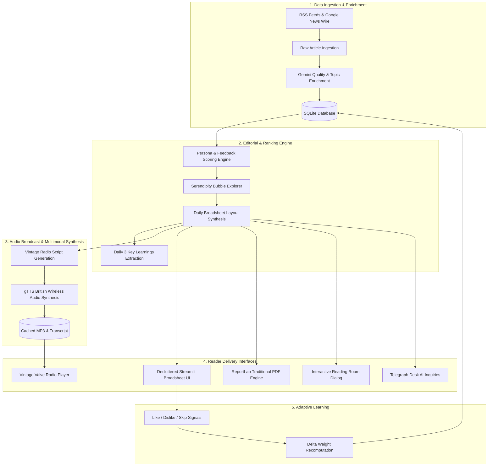

# 📰 The Daily Brew: Your Personal Morning Paper & Wireless Broadcast

> **AI Hackathon Project** — Inspired by traditional broadsheet newspapers and historic radio news desks, engineered for the modern information age.

---

## 💡 The Problem & The Solution

**The Problem**:
News is scattered across dozens of websites, apps, and newsletters. Readers jump from link to link and still can't name three things they learned. Algorithmic feeds trap users into polarization silos and clickbait loops.

**The Solution**:
**The Daily Brew** gathers stories across the web every day, filters out clickbait and fluff, tailors coverage to the reader's persona and declared interests, and publishes a cohesive daily morning paper. It features:
1. **Classic Vintage Broadsheet Web Page**: A decluttered, balanced 3-column newspaper grid with authentic editorial typography, drop caps, and curator notes.
2. **The Daily 3: What You Learned Today**: An executive summary bulletin that distills three memorable key learnings from the global wire.
3. **The Morning Wireless Broadcast 📻**: An authentic 1940s-style audio radio news briefing narrated in crisp British morning wireless style for coffee breaks and commutes, complete with audio downloads and full teletype scripts.
4. **The Reading Room Modal**: Distraction-free story clippings with on-demand single-story audio narration (`🎧 Listen to Story`).
5. **The Telegraph Desk (Ask Your Chief Editor)**: An interactive wire where readers can telegram questions to their personal AI editor grounded directly in today's stories.
6. **Outside Your Bubble (Serendipity Engine)**: Purposefully selected high-rigor journalism outside the reader's usual circle to break algorithmic echo chambers.
7. **Daily Broadsheet PDF Export**: Print-ready, traditional newspaper layout matching the user's chosen aesthetic palette.
8. **Adaptive Real-Time Learning**: Continuous weight adaptation that visibly updates preference gauges as readers upvote, downvote, or dismiss articles.

---

## 🏛️ System Architecture



---

## 🚀 Key Features Walkthrough

### 📻 1. The Morning Wireless Broadcast
- Synthesizes a 90-second charismatic morning radio news dispatch tailored to the reader.
- Styled as a classic 1930s vacuum tube radio player with frequency tuning, "ON AIR" indicator, and speed/volume controls.
- Expandable typewriter broadcast script and instant `.mp3` download for offline commuting.

### 💡 2. The Daily 3 (What You Learned Today)
- Directly addresses the core hackathon problem: *"People jump from link to link and still can't name three things they learned."*
- Distills 3 clear, unforgettable takeaways from the morning wire.

### 📰 3. Decluttered Vintage Broadsheet Design
- Harmonious, balanced 3-column newspaper grid.
- Prominent Lead Story with vintage drop cap, reading time pill, and curator notes.
- Seamless reading modes: **Broadsheet Front Page**, **3-Minute Espresso Scan**, and **Outside Your Bubble**.

### 📖 4. Distraction-Free Reading Room
- Click **"📖 Read & Listen"** on any story to open a clean reading clipping dialog.
- Includes full editorial summary, key takeaways, and on-demand story narration (`🎧 Listen to Story`).

### ✉️ 5. The Telegraph Desk
- Send an inquiry to your Chief Editor.
- The editor answers with authority and wit, grounding responses in today's published dispatches.

### 🎨 6. Authentic Broadsheet Themes & PDF
- Themes include: **Classic Broadsheet**, **Modern Midnight**, **Financial Salmon**, **Morning Roast**, **Nordic Minimalist**, and **Cyber Terminal**.
- One-click downloadable print-ready PDF styled with traditional column rules, headlines, and footers.

---

## 🛠️ Quickstart

### 1. Clone & Set Up Environment
```bash
git clone https://github.com/your-username/The-Daily-Brew.git
cd The-Daily-Brew
python -m venv venv
.\venv\Scripts\activate
pip install -r requirements.txt
```

### 2. Configure Environment Variables
Create a `.env` file in the root directory:
```ini
GEMINI_API_KEY=your_gemini_api_key_here
```

### 3. Seed Demo Data (Optional)
```bash
python scripts/seed_demo.py --days 4
```

### 4. Run the Application
```bash
streamlit run app.py
```
Open [http://localhost:8501](http://localhost:8501) in your browser.
Demo reader credentials:
- **Username**: `alex` / `sara` / `drkhan`
- **Password**: `demo123`
